# Promoting an image to the other clouds

> **Audience:** operator · **Profile:** `demo` · **Read this when:** you built an image in one cloud and want it in the others, through the storage backend.

Part of [Image Management](../image-management.md).

The lifecycle this doc is mostly about, surfaced on the
**`/images`** page. Source of truth: the image artefact (VHD by default)
sitting in your **hub backend**, recorded as a `RegisteredImage` row.
Targets: AMI / Managed Image / Custom Image, one or more.

The end-to-end flow:

```mermaid
flowchart LR
    build["Packer build<br/>AWS / Azure / GCP / OCI"] --> export["Native export to<br/>same-cloud storage"]
    export -- "same-backend as hub<br/>(no copy)" --> hub[("Hub backend<br/>S3 / Blob / GCS")]
    export -- "different cloud<br/>(cross-backend copy)" --> hub
    hub -- "presigned URL" --> runner["Target-cloud runner<br/>ECS / ACI / Cloud Run"]
    runner -- "qemu-img convert<br/>+ upload" --> staging[("Target-cloud staging")]
    staging --> imp["Cloud import API<br/>ec2.ImportImage<br/>images.create_or_update<br/>images.insert"]
    imp --> ami["Native image<br/>AMI / Managed Image / Custom Image"]
    ami --> promo["RegisteredImage.promotions"]
    style hub fill:#e0e7ff
    style ami fill:#d1fae5
```

## Build → hub

After a successful Packer build the dashboard exports the image to a
portable VHD via the cloud's native API and lands it on the **hub**
backend, recording the resulting URL on `RegisteredImage.artefact_url`.
You set the hub on `/storage` via `storage_hub_backend`; if unset it
falls back to the active backend (so single-backend installs Just
Work without configuration). Per build cloud:

- **AWS** — `ec2:ExportImage` writes a VHD to S3. Requires the
  `vmimport` IAM service role; override the role name with
  `aws_vmimport_role_name` if you've named yours differently.
- **Azure** — Snapshot the managed image's OS disk, grant a read-only
  SAS URL, server-side blob-copy into the configured Azure Blob
  container as a VHD, then revoke and clean up the snapshot. No
  egress through the dashboard.
- **GCP** — Submit a Cloud Build job running the upstream
  `gcr.io/compute-image-tools/gce_vm_image_export` Daisy workflow
  with `-format=vpc`, writing the VHD to GCS.

When the build cloud matches the hub backend, the native export *is*
the hub upload — no extra copy. When they differ (e.g. AWS build with
hub = Azure Blob), the dashboard runs `storage_service.copy()` to move
the VHD from same-cloud staging into the hub, then deletes the
staging copy so you don't pay for two. With the hub on Azure Blob the
copy is fully server-side: the staging object gets a presigned URL and
the Azure storage service pulls each block itself, so no image bytes
transit the dashboard container. With the hub on S3/GCS/OCI and a
*different* build cloud, the copy stages through the container's
ephemeral disk — which multi-GB VHDs can overflow — so for
cross-cloud building either put the hub on Azure Blob or match it to
the build cloud. See `_land_on_hub()` in
[`services/packer_build_service.py`](../../../web_dashboard/services/packer_build_service.py).

## Manual export (recovery path)

The auto-export above is part of every successful Packer build, but
sometimes it gets skipped — no S3 bucket configured, no Azure storage
account on the `/storage` page, the export task timed out mid-build,
etc. The Packer build still completes and the cloud-native image (AMI
/ Managed Image / Custom Image) is fine; it just isn't on the hub and
isn't registered for cross-cloud promotion.

To recover without rebuilding, every cloud Images tab has an
**Export VHD** action on each existing image:

- **AWS Private AMIs** — Export VHD button alongside Deploy / Delete.
- **Azure Managed Images** — Export VHD action.
- **GCP Custom Images** — Export VHD on each image card.

Clicking it prompts for a registry name (defaults to a sanitized
version of the image's native name), then runs the same export →
land-on-hub → register flow that the Packer post-build path runs.
You're redirected to `/jobs/<id>` for live progress. End-to-end this
takes 15–60 minutes depending on image size and whether the build
cloud is the hub cloud (no copy) or a different cloud (cross-backend
copy).

Endpoints behind the buttons:
- `POST /api/aws/amis/{ami_id}/export`
- `POST /api/azure/images/{image_name}/export` (optional
  `resource_group` in body; defaults to `azure_resource_group`)
- `POST /api/gcp/images/{image_name}/export`

Each takes `{image_name: <registry name>}` and returns
`{job_id, status, message}`. Same cloud-storage prerequisites apply
as for the auto-export — AWS needs an S3 bucket, Azure needs a
storage account, GCP needs a GCS bucket. The job log surfaces a
clear "Export skipped: no S3 bucket configured" (or equivalent) if
the prerequisite is missing.

## Pre-flight checks

The **Promote** modal runs an advisory pre-flight check the moment
you pick a target cloud. The checks are pure-Python (no cloud-side
API calls, returns in <100ms) and cover the local-state blockers
visible without leaving the dashboard:

- Artefact recorded — `artefact_url` and `artefact_format` are set
- Format compatibility — VHD/VMDK/RAW/OVA matrix per target cloud
- Cross-storage copy required — informational, since the runner
  handles it automatically
- Target credentials configured — the dashboard's config store has
  the credentials the target cloud's import API will use

Failing checks don't block — the **Promote** button still works —
but they're surfaced visually so the operator doesn't kick off a
30-minute import only to discover credentials were missing. The
endpoint is `POST /api/images/{id}/preflight` with `{target_cloud}`
body; response shape is `{checks: [{name, status: pass|warn|fail, detail}]}`.
Runner-time errors (IAM mid-flight, quota, format quirks) surface
on `/jobs/<id>` once the actual promote runs.

## Automated cross-cloud promote

When you click **Promote** on an image, the dashboard enqueues an
`image_promote_<target>` Job and runs the conversion + import in a
transient container in the *target* cloud:

| Target | Runner | Cloud SDK call | Conversion |
|---|---|---|---|
| AWS | ECS Fargate task | `ec2.ImportImage` | None (VHD passthrough) |
| Azure | ACI container group | `compute.images.begin_create_or_update` | None (VHD passthrough) |
| GCP | Cloud Run Job | `compute.images.insert` | `qemu-img vhd → raw` + `tar.gz`-wrap with `disk.raw` entry |
| OCI | Container Instance | `compute.create_image` (Object Storage tuple) | `qemu-img vhd → qcow2` (OCI import reads QCOW2) |

The runner pulls the hub artefact via a short-lived presigned URL
minted at task-launch time, so it never holds hub-side credentials.
On exit the dashboard calls the cloud's image-import API against the
staged blob, polls until the resulting image is `Available` /
`Succeeded` / `READY`, then deletes the staged copy and records the
final identifier on `RegisteredImage.promotions[<target>]`.

The runner image is `chrweav/dashboard-promote-runner:latest`
by default; override via `promote_runner_image` if you maintain a
hardened private build. See
[`runners/promote/README.md`](../../../runners/promote/README.md) for the
operator prerequisites (IAM, quotas, networking) per target cloud,
the full list of `promote_runner_*` config keys, and local build
instructions for maintaining a custom or hardened build.

If your dashboard credentials can't reach the target — e.g. cross-
account promotes or air-gapped tenants — pass `?manual=1` on the
promote endpoint (or click "Show manual steps instead" in the modal)
and the dashboard returns the operator-runnable CLI walkthrough as
before. The promotion is recorded as `manual` in the registry; run
the commands yourself, then re-promote (or `record_promotion` via the
API) to fill in the resulting native image ID.

Format expectations per target:

| Target | Native import format | Path |
|---|---|---|
| AWS | VMDK / OVA / RAW / VHD via `ec2.ImportImage` | hub → staging S3 → `import-image` task → AMI |
| Azure | VHD via `Microsoft.Compute/images` | hub → staging Blob → `images.create_or_update` → Managed Image |
| GCP | tar.gz containing `disk.raw` via `images.insert` | hub → staging GCS → `images.insert` → Custom Image |
